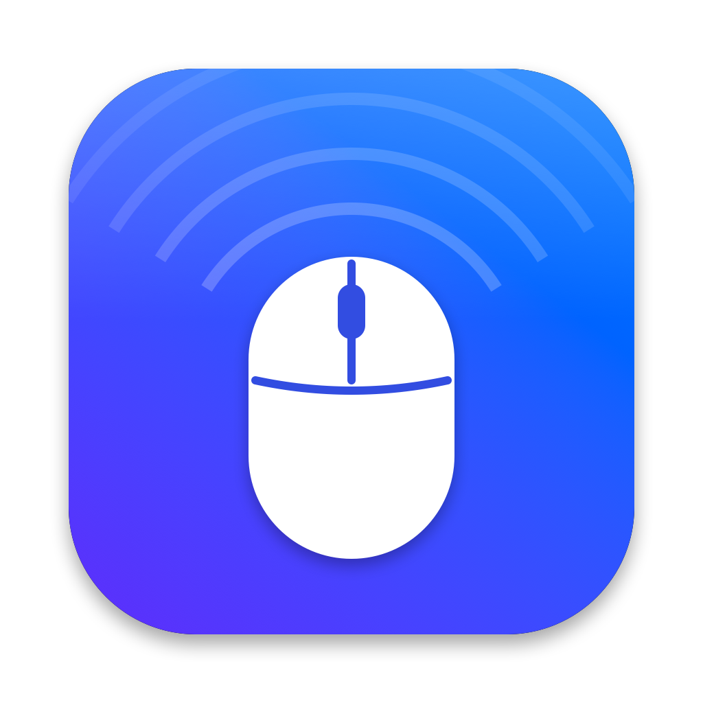
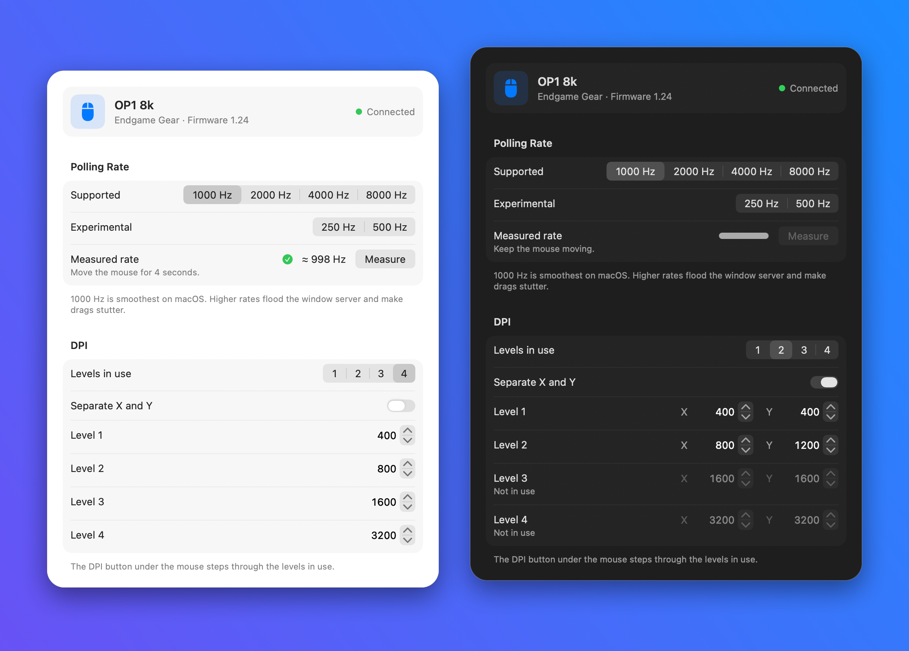
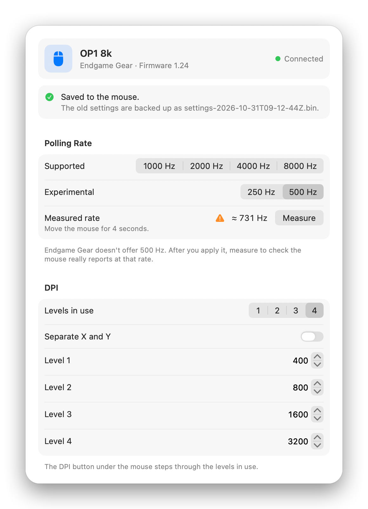
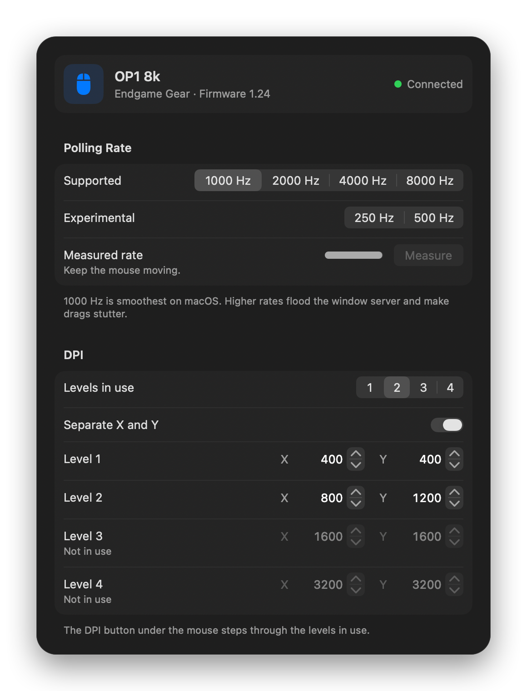
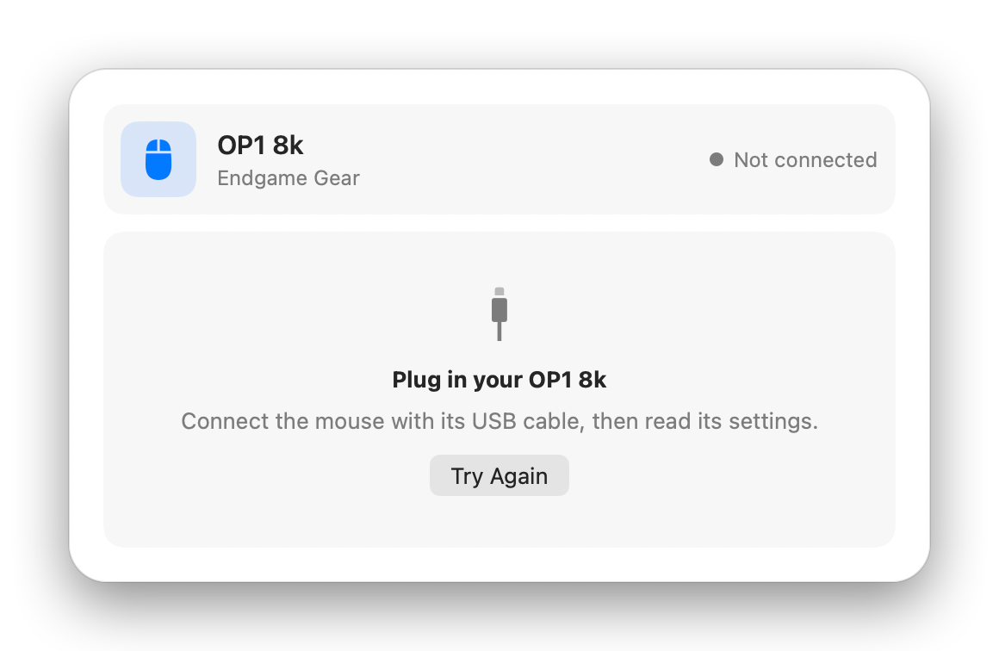
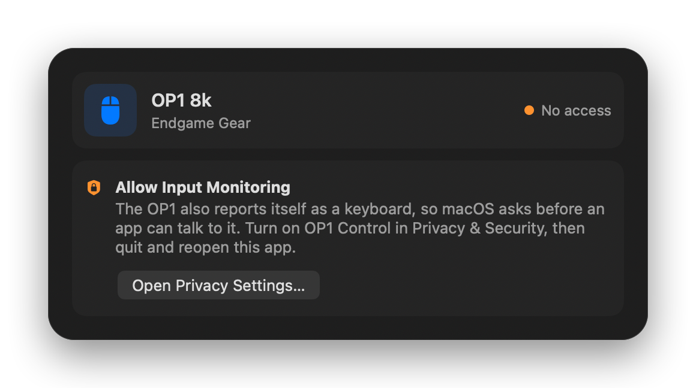

<div align="center">



# OP1 Control for Mac

**Set the polling rate and DPI of your Endgame Gear OP1 8k on macOS, with no Windows PC needed.**

[](https://github.com/rm2kdev/OP18K-Mac-Control-Panel/releases/latest/download/OP1Control.zip)




</div>

---

## Why this exists

The OP1 8k ships polling at **8000 Hz**, and Endgame Gear's configuration tool only runs on Windows.

macOS doesn't cope well with 8000 updates a second. The window server falls behind and anything you drag stutters: windows, the screenshot selection border, sliders. The trackpad stays smooth, which makes it look like the Mac is slow when the mouse is the cause.

**OP1 Control** is a small native Mac app that talks to the mouse directly. Set it to 1000 Hz, click **Apply**, and dragging is smooth again. The setting is stored on the mouse, so it stays after you unplug it or move it to another computer.

## Features

|  |  |
| --- | --- |
| 🎚️ **Polling rate** | 1000, 2000, 4000 or 8000 Hz, the rates Endgame Gear supports |
| 🧪 **Experimental rates** | 250 and 500 Hz, which the official tool doesn't offer (500 Hz has been tested on firmware 1.24) |
| 🎯 **DPI levels** | 1 to 4 levels the DPI button steps through, 50 to 26000 DPI in steps of 50 |
| ↔️ **Separate X and Y** | A different horizontal and vertical DPI for any level |
| 📈 **Measure** | Counts the reports the mouse really sends while you move it, then checks them against the rate you set |
| 💾 **Automatic backups** | Saves the mouse's old settings before every write |
| ✅ **Verified writes** | Reads the settings back after each write and compares them byte for byte |
| ⌨️ **Native Mac app** | SwiftUI, light and dark mode, a Mouse menu with shortcuts, VoiceOver labels |
| 🖥️ **Command line tool** | `op1ctl` for scripts and terminal use |

## Install

1. Download **[OP1Control.zip](https://github.com/rm2kdev/OP18K-Mac-Control-Panel/releases/latest/download/OP1Control.zip)** from the latest release.
2. Unzip it and drag **OP1 Control** into your **Applications** folder.
3. Open it. macOS asks for **Input Monitoring**. Turn it on, then quit and reopen the app.

> **Why Input Monitoring?** The OP1 also reports itself as a keyboard, so macOS asks before any app can talk to it. OP1 Control only talks to the OP1 and never records what you type.

### First launch: "Apple could not verify…"

The app is signed with a Developer ID but not notarized, so on the first launch macOS shows a warning. To open it:

1. Click **Done** on the warning.
2. Open **System Settings → Privacy & Security** and scroll down to the **Security** section.
3. Next to *"OP1 Control" was blocked*, click **Open Anyway** and confirm.

You only do this once. If you prefer the terminal: `xattr -dr com.apple.quarantine /Applications/OP1Control.app`

## Screenshots

<table>
  <tr>
    <td align="center"><br><sub>Saved to the mouse, with an experimental rate measured</sub></td>
    <td align="center"><br><sub>Separate X and Y DPI, while measuring</sub></td>
  </tr>
  <tr>
    <td align="center"><br><sub>No mouse plugged in</sub></td>
    <td align="center"><br><sub>Waiting for Input Monitoring</sub></td>
  </tr>
</table>

## Keyboard shortcuts

| Action | Shortcut |
| --- | --- |
| Apply changes | <kbd>⌘</kbd> <kbd>S</kbd> |
| Read settings again | <kbd>⌘</kbd> <kbd>R</kbd> |
| Measure polling rate | <kbd>⇧</kbd> <kbd>⌘</kbd> <kbd>M</kbd> |
| Revert changes | Mouse → Revert Changes |
| Show backups in Finder | Mouse → Show Backups in Finder |

## Command line

`op1ctl` ships inside the app:

```bash
alias op1ctl="/Applications/OP1Control.app/Contents/MacOS/op1ctl"
```

```text
op1ctl info              show polling rate, firmware and DPI levels
op1ctl rate <hz>         set the polling rate: 1000, 2000, 4000 or 8000 (250 and 500 are experimental)
op1ctl dpi <level> <dpi> [<y-dpi>]
                         set a DPI level (1-4), 50-26000 in steps of 50
op1ctl dpi-levels <n>    set how many levels the DPI button steps through (1-4)
op1ctl dump              print the raw settings block
op1ctl restore <file>    write back a settings backup
op1ctl selftest          check the protocol code (no mouse needed)
```

The terminal you run it from needs Input Monitoring too (System Settings → Privacy & Security → Input Monitoring).

## Compatibility

| | |
| --- | --- |
| **Mouse** | Endgame Gear **OP1 8k (v1)**, USB ID `3367:1964`, wired |
| **Firmware** | Tested on 1.24 |
| **macOS** | 26 or later, Apple silicon or Intel |
| **Not supported** | OP1 8k **v2**. It uses a different MCU, sensor and protocol. |

OP1 Control never touches firmware. It reads and writes only the mouse's settings block, the same one the official tool uses.

## How it works

The protocol comes from Endgame Gear's own Windows configuration tool (V1.12) and was checked against a real mouse. The mouse takes two HID feature reports on its vendor interface (usage page `0xFF01`):

| Report | Size | Purpose |
| --- | --- | --- |
| `0xA1` | 64 bytes | Commands: `0x12` load settings, `0x02` firmware version |
| `0xA0` | 1041 bytes | The settings: a 16-byte header, then 1024 bytes of settings |

Inside the 1024-byte settings block:

| Offset | Meaning |
| --- | --- |
| 5 | Polling rate as a divider of 8000 Hz: `8`=1000, `4`=2000, `2`=4000, `1`=8000 (`16`=500, `32`=250) |
| 13 | The DPI level the mouse is on now (never written) |
| 14 | How many DPI levels are in use, 1 to 4 |
| 35–54 | Four 5-byte DPI levels: a split flag, then X and Y as little-endian 16-bit values |

Every other byte is written back exactly as it was read. Before a write, the app checks that the block looks like an OP1 8k v1 block, and it refuses to write anything else.

## Build from source

The Command Line Tools are enough; you don't need Xcode.

```bash
git clone https://github.com/rm2kdev/OP18K-Mac-Control-Panel.git
cd OP18K-Mac-Control-Panel
./build.sh --open
```

`build.sh` builds, runs the protocol self-test, installs to `~/Applications/OP1Control.app` and opens it. `./release.sh` makes the signed universal `dist/OP1Control.zip` that goes on the Releases page.

```text
Sources/
  OP1Kit/       protocol, device access, rate meter, self-test
  OP1Control/   the SwiftUI app
  op1ctl/       the command line tool
tools/          icon and README image scripts
docs/           user stories, glossary, fix log, images
```

## Safety

- Every write is preceded by a backup in `~/Library/Application Support/OP1Control/backups`. Restore one with `op1ctl restore <file>`.
- **The experimental rates are not supported by Endgame Gear.** They use the same mechanism as the official rates. 500 Hz has been tested on firmware 1.24; 250 Hz has had less testing. If you'd rather not risk anything, stick to 1000–8000 Hz.
- This is an unofficial tool, provided as is, without warranty. Use it at your own risk.

## Credits

Built with [Claude Code](https://claude.com/claude-code) and [bama](https://github.com/daveebbelaar/bama).

## License

[MIT](LICENSE). Not affiliated with or endorsed by Endgame Gear. "Endgame Gear" and "OP1" are trademarks of their owners.
